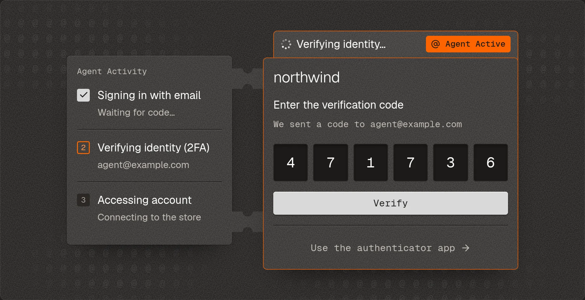
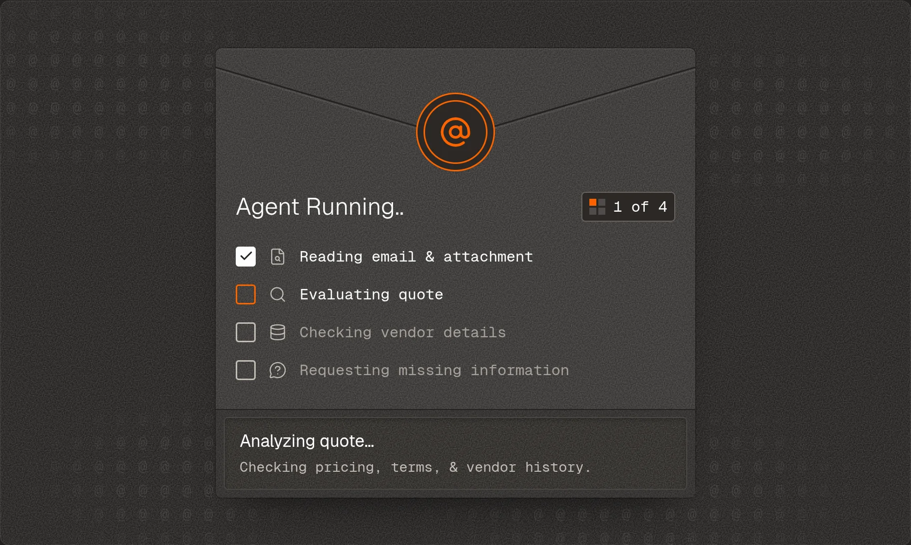
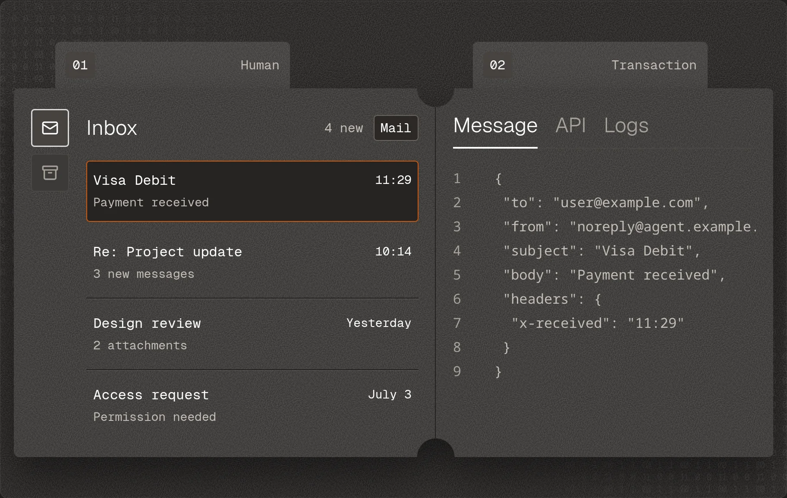
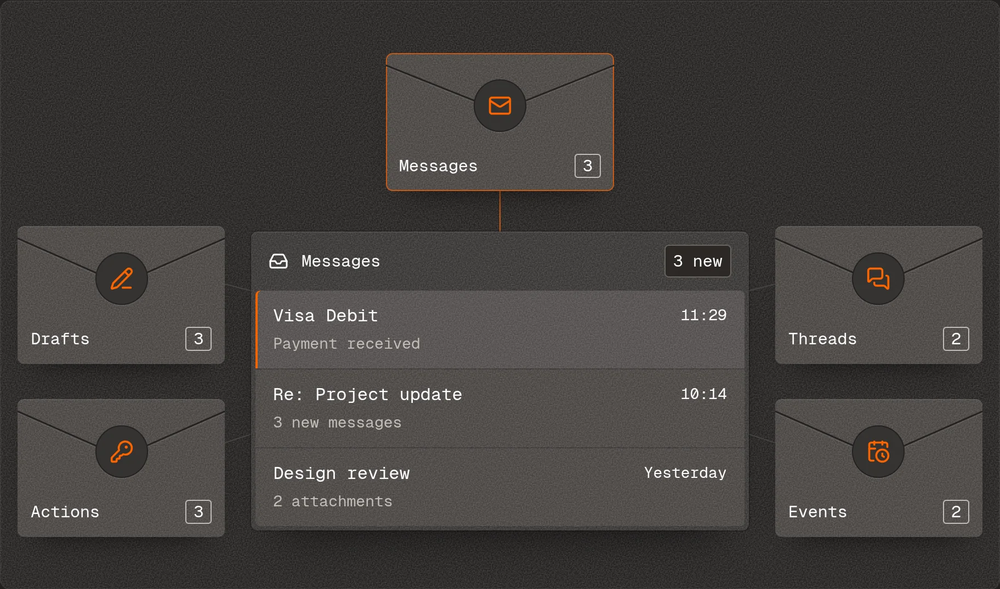
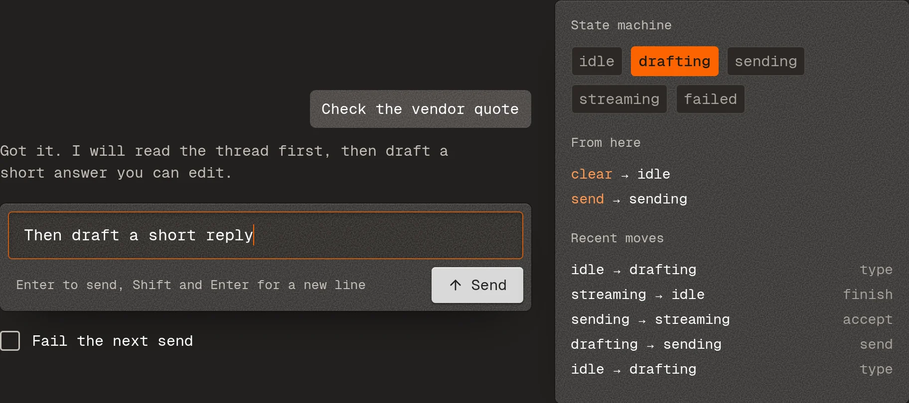
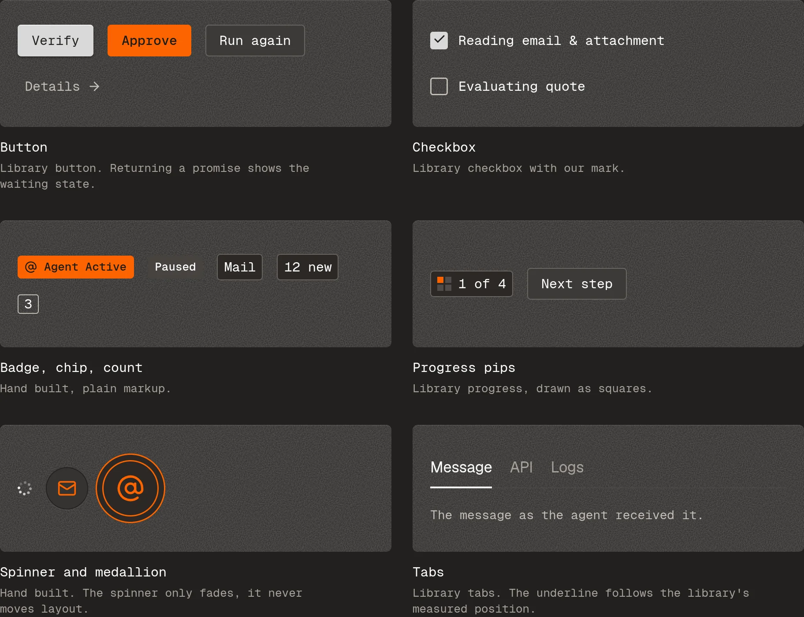
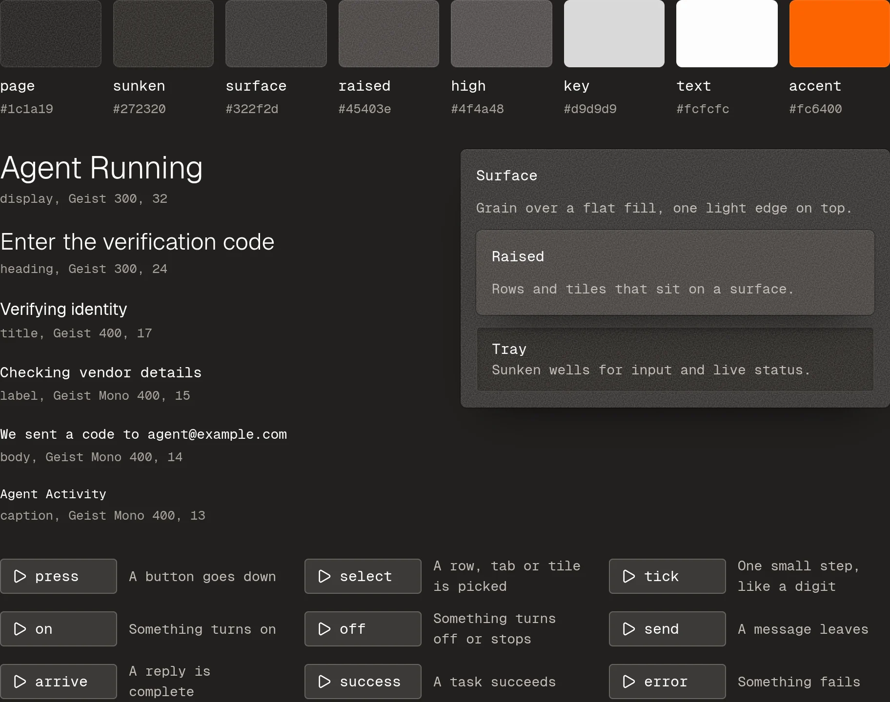

# Kiln

A small design system for agent interfaces, built to find out how good [Vercel UI SDK](https://github.com/vercel-labs/ui) is as a base.

The library brings the behavior: keyboard, focus, selection and ARIA. Kiln brings the look and the feel: warm dark surfaces with grain, one ember accent, Geist and Geist Mono, and real sound on every interaction.

It is not deployed anywhere. Everything it has is on this page, and it runs locally in two commands.

## Scenes

Four screens built only from Kiln parts. All of them are live in the demo: you can type, tab and click.







## Composer

The one component the library does not ship. It is a single primitive written with the library's own building blocks, around a state machine with five phases.



| Phase | Signals it accepts |
| --- | --- |
| idle | type |
| drafting | clear, send |
| sending | accept, finish, fail, stop |
| streaming | finish, fail, stop |
| failed | type, clear, retry |

- The text leaves the box the moment you send, and comes back if the send fails or you stop it.
- Arrow up brings back earlier messages.
- Focus returns to the box when Send turns into Stop.
- An app can refuse any move, for example to block a send.

## Parts



## Foundations

Colors, type, layers and sound cues. Every value is a token in `src/styles/tokens.css`.



## Sound

Sound is part of the system, not something each component adds.

UI SDK reports every change a component makes, with the component, what changed and why. Kiln listens once for the whole page and turns those changes into nine cues: `press`, `select`, `tick`, `on`, `off`, `send`, `arrive`, `success` and `error`. A new component needs one line in `src/system/sound/rules.ts` and no sound code of its own.

- A mouse sounds on the way down. Touch waits for the tap, so a scroll that starts on a button stays silent.
- Typing is always silent. Disabled controls are silent.
- One toggle turns it all off, and the choice is remembered.
- The sounds are real recordings by [Kenney](https://kenney.nl), from the [soundcn](https://www.soundcn.xyz) registry. Pull another one with `bun scripts/sound.ts <name>`.

## What came from where

| From UI SDK, styled with CSS only | Built by hand | Built from UI SDK building blocks |
| --- | --- | --- |
| Button, checkbox, code input, field, listbox, tabs, toggle group, timeline, progress, separator | Stage, panel, tray, ticket, envelope, medallion, badge, chip, spinner, code block | Composer, sound listener |

## Run it

```
bun install
bun run dev
```

Then open `http://127.0.0.1:5240`.

```
bun run check
bun run lint
bun run test
```

## Layout

```
src/styles      tokens and base styles
src/system      the design system
  composer      state machine, primitive, renderer
  sound         cues, rules, engine, recordings
src/showcase    the demo page
```

## Credits

- [Vercel UI SDK](https://github.com/vercel-labs/ui) for the behavior layer. It is in public beta, so Kiln pins `0.1.0-beta.3`.
- [soundcn](https://www.soundcn.xyz) and [Kenney](https://kenney.nl) for the sounds (CC0).
- [Geist](https://vercel.com/font) and Geist Mono for type.
- [Lucide](https://lucide.dev) for icons.
- The scenes began as studies of reference images of agent mail interfaces.
